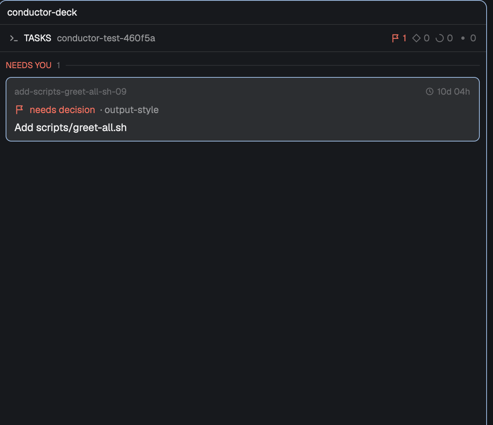

# conductor-deck

Conductor task visualizer for Herdr.

A [Herdr](https://herdr.dev) mod that shows [conductor](https://github.com/erd/conductor) tasks as
cards in a pane beside the conductor.



Cards sit in sections, most urgent first:

- **NEEDS YOU:** a permission prompt, an open decision, a `blocked` report or requested changes
  (flag), or a failure (cross).
- **REVIEW:** in review (diamond), or ready to merge (arrow).
- **IN PROGRESS:** a running worker (spinner), or an idle or exited one (half circle).
- **TODO:** no worker yet (dot).
- **DONE:** merged, one row each (check).

Each card shows:

- its id, and the time in its state;
- its state, and what the worker is on;
- the task's title, up to three lines;
- its branch;
- its PR, with checks and review.

The deck reads tasks from `conductor deck --json`. It reads them again whenever conductor's
state for the repo changes, and mixes in each worker's live status from Herdr.

Using the deck with the herdr TUI? That's
[v0.3.0](https://github.com/erd/conductor-deck/tree/v0.3.0), the last release of the herdr plugin.

## Requirements

- Herdr.app 0.1.15 or later, with herdr-core (`hc`) 0.1.20 or later.
- A conductor with `conductor deck --json`, from
  [erd/conductor](https://github.com/erd/conductor) after its port to the Herdr app (#56).
- Local spaces only. A space on another machine shows "Remote spaces aren't supported yet".

## Install

Herdr doesn't hot-reload a symlinked mod, so the mod is copied into the app's mods folder:

```sh
git clone https://github.com/erd/conductor-deck
cd conductor-deck
scripts/sync.sh                                   # copies mods/conductor-deck into ~/.config/herdr-app/mods
herdr-app check ~/.config/herdr-app/mods/conductor-deck
```

Set `HERDR_APP_HOME` to install it into another Herdr home. Run `scripts/sync.sh` again after
pulling.

## Placement

### A pane beside the conductor (default)

Once the mod is installed, conductor's `SessionStart` hook opens a deck to the right of the
conductor whenever a conductor session starts afresh. It runs `herdr-app do pane.split
--direction right --mod conductor-deck --props '{"space":"<space>"}'`. You set the width by
dragging the divider. Herdr saves the pane with the tab, so you see the deck only while you're on
the conductor's tab.

The deck keeps one copy per tab: if the hook opens a second deck where one is already open, the
second closes itself.

To open a deck yourself, merge [`keys.json`](keys.json) into `~/.config/herdr-app/keys.json`. It
binds `cmd-shift-k` to:

```json
{ "command": "pane.split", "args": { "direction": "right", "mod": "conductor-deck" } }
```

Press `q` in the deck to close it.

### A column in your own layout

For a deck on every tab, with a width that stays fixed, clone the `main` layout
(`layout.clone`). Then add a block to its right-hand side:

```json
{ "id": "deck", "type": "block", "size": { "px": 360 }, "content": { "mod": "conductor-deck" } }
```

`layout.toggle { "id": "deck" }` on a key shows or hides it. Opened without a `space`, the deck
follows the focused space. The cost: a cloned layout stops following Herdr's updates to `main`.

## Keys

Keys reach the deck while it has the keyboard: click it, or use `pane.go`.

| Key | Does |
| --- | --- |
| `j`/`k`, `↓`/`↑` | Move the selection. The wheel scrolls. |
| `Enter`, click | Jump to the card's worker. If its terminal is gone, `conductor resume` restarts it. |
| `m` | Message the card's worker: type a line, `Enter` sends it with `hc send`, `Esc` cancels. A worker waiting on a prompt can't be messaged; jump to it instead. |
| `d` | Answer the card's open decisions in a dialog (see below) |
| `o` | Open the card's PR in the browser |
| `c` | Jump to the conductor |
| `z` | Fold or unfold the Done section |
| `L` | Show or hide torn-down and abandoned tasks |
| `q` | Close the deck |

`d` opens a dialog over the window, 70% of its width and height, showing the oldest open
decision. In the dialog:

- `↑`/`↓` (or `j`/`k`) choose an option, and the recommended one is marked `REC`.
- `Tab` moves to the note, and back.
- `n`/`p` show the next or previous open decision.
- `Enter` answers, and `Esc` cancels.
- A decision that allows free text has a last `other…` row, which answers with what's typed.

The deck records the answer with `conductor decision answer … --by deck`, then types "Decision
`<key>` answered: `<label>`. Check `conductor decision list` and continue." into the worker. The
dialog closes once that's done. If the answer fails, the dialog stays open and says why.

## Development

```sh
npm test                 # node --test on the pure modules
scripts/sync.sh --watch  # copies the mod into Herdr on every save; Herdr reloads it
herdr-app status         # mod errors, including failed reloads
herdr-app shot           # a PNG of the window
```

Under `mods/conductor-deck/`:

| File | Does |
| --- | --- |
| `main.js` | The entry point: the deck, or the decision dialog when opened with `view: "decide"` |
| `deck.js` | The deck view |
| `decide.js` | The decision dialog |
| `model.js` | The cards |
| `feed.js` | Parsing conductor's output, and the conductor and `hc` argv |
| `decide-model.js` | The dialog's state |
| `icons/` | The deck's icons, tinted from the theme |

`model.js`, `feed.js` and `decide-model.js` don't import Herdr's runtime, so `node --test` loads
them directly. `tests/fixtures/feed.json` is conductor's own feed snapshot. CI runs the tests and
`node --check` on every module.

[`RECIPE.md`](RECIPE.md) describes the mod for [herdr.dev/mods](https://herdr.dev/mods).

### Releasing

[release-please](https://github.com/googleapis/release-please) keeps a release PR open that
bumps `package.json` and `CHANGELOG.md` from the conventional commits since the last `v*` tag.
Merging it tags `v<version>` and creates the GitHub release.

## License

Licensed under the [Apache License, Version 2.0](LICENSE).
