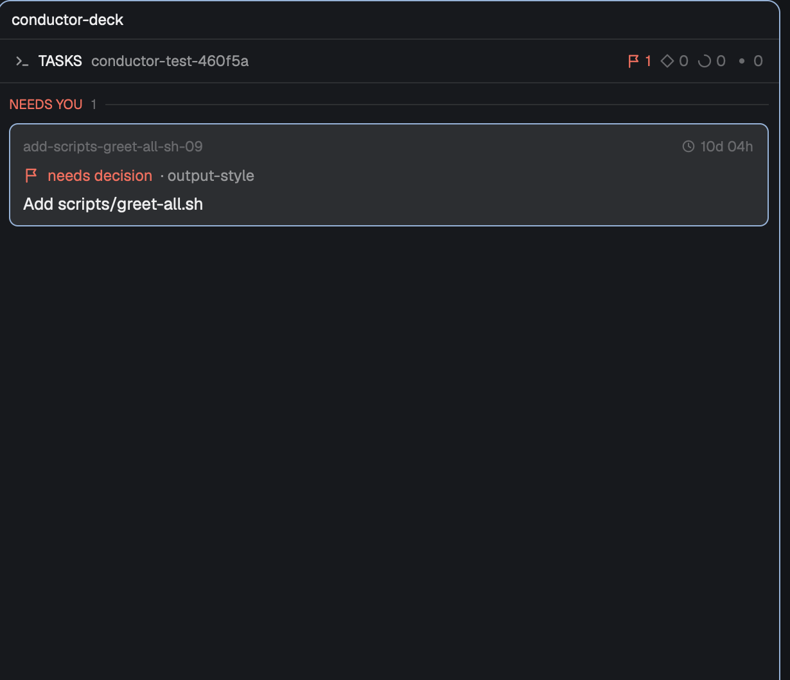

# conductor-deck

The deck is a pane beside a [conductor](https://github.com/erd/conductor) session. It shows
each of the repo's tasks as a card, sorted so that whatever needs you is on top: a worker at a
permission prompt or with an open question, a failure, a PR waiting to merge, the workers still
running, and the tasks not yet started. From the deck you can jump to a worker, message it, or
answer its question.

## What you see

All colors come from `theme()`.

**Header** (34px, with a `border` line below it):

- A terminal icon, then `TASKS` (11.5px, semibold), then the repo id (muted, truncated).
- On the right, a count for each of four sections, each with that section's icon: NEEDS YOU
  (`blocked`), REVIEW (`accent`), IN PROGRESS (`working`) and TODO (`muted`). A section with no
  cards is drawn `dim`.

**Body:** a scrolling column with 8px side padding and 6px between items. Each section opens
with a rule: the label (10.5px, semibold), its count, then a 1px `border` line to the right edge.

| Section | Holds | Label color |
|---|---|---|
| NEEDS YOU | needs permission, needs decision, blocked, changes requested, failed, checks failing | `blocked` |
| REVIEW | in review, ready to merge | `dim` |
| IN PROGRESS | working, idle, exited | `dim` |
| TODO | intake, briefed, spawning | `dim` |
| DONE | merged, torn down, abandoned | `dim` |

**Cards** in every section but DONE: 10px × 8px padding, 7px corners, 1px border, `surface`
background. Top to bottom:

1. The task id (11px, `dim`). On the right, a clock icon and the time in this state.
2. The state icon and the state word (12px, medium, in the state's color), then `· detail`
   (`muted`, truncated). The detail is the permission prompt, the decision key (plus `+n`), the
   blocked or failed report, the running tool, or the turn's error.
3. The title (13px, line height 1.3, cut after three lines).
4. The branch, after a branch icon, if there is one.
5. The PR, after a PR icon, if there is one:
   - `PR #42 draft` / `ready` / `merged` / `closed`;
   - `· checks` with a check (`done`), a cross (`ansi1`) or a dot (`dim`);
   - `· approved` (`done`), `· changes requested` (`ansi1`) or `· review required`.

The selected card has an `accent` border and a `selected` background. NEEDS YOU cards have a
`blocked` border.

**DONE rows** are one line each: the state icon, the id, the title (truncated), and the elapsed
time, all `dim` (in the foreground color when selected). The DONE rule has a chevron that folds
the section.

**Footer** (with a `border` line above it):

- A read error, in `ansi1`: `! task <id>: <error>`.
- A toast (`accent`) for four seconds after an action.
- While messaging, an input box with an `accent` border.
- A hint line (10.5px, `dim`): `⏎ focus · m msg · d decide · o PR · c conductor · z fold done ·
  L show all · q close`, with `i/n` on the right.

**State icons** (14 stroke SVGs on a 16px grid, tinted by text color):

| State | Icon | Color |
|---|---|---|
| needs you | flag | `blocked` |
| failed | circled cross | `ansi1` |
| working | arc, spinning (`.spin(900)`) | `working` |
| idle or exited | half-filled circle | `dim` |
| in review | diamond | `accent` |
| ready to merge | up arrow | `ansi4` |
| not started | dot | `dim` |
| merged | check | `done` |
| torn down | check | `dim` |
| abandoned | cross | `dim` |

**Empty states**, centered: "Reading tasks…", "No conductor here" with conductor's error,
"Remote spaces aren't supported yet", "No space", or "no tasks".

**The decision dialog** (`d`, 70% × 70% of the window, `popover` background, 18px padding):

1. `<task>: <key>`, with `i/n` and `Esc` on the right.
2. The question (16px, semibold).
3. The context, `muted`. Lines starting `- ` are bullets with hanging indents.
4. The options: a `›` on the chosen one, its label (semibold when chosen), and its hint below in
   `dim`. The recommended option has a `REC` tag outlined in `accent`. A decision that allows
   free text ends with an `other…` row.
5. A `note ›` input. It reads `answer ›` while `other…` is chosen.
6. A message line, then hints.

## How it behaves

**Card states** mix the feed with the app's live `agents()` status, matched on the worker's
terminal address:

- An app status of `blocked` counts as a permission prompt.
- An app status of `working` counts as a running worker. A running worker moves a card that's
  in review back to IN PROGRESS.
- A closed or merged PR never needs attention.

**Order:** by section, then oldest in its state first, then by id.

**Elapsed time** is shown to the minute: `<1m`, `4m`, `1h 05m`, `3d 04h`. One timer fires when
the next shown value changes, so the deck redraws at most once a minute.

**Freshness:** the deck re-runs `conductor deck --json` 150 ms after the last change under the
repo's state dir (`watchFolder`). It never polls. Worker status updates live, because `render`
reruns when `agents()` changes.

**Keys**, while the deck has focus (`focusable: true`; click it, or use `pane.go`):

| Key | Does |
|---|---|
| `j`/`k`, `↓`/`↑` | move the selection, scrolling it into view |
| `Enter`, click | `agent.focus` on the worker's terminal |
| `m` | Opens the message box. `Enter` runs `hc send <terminal> <text>`. Exit 9: "worker is waiting on a prompt"; exit 3 or 11: "worker is gone; run `conductor resume`". |
| `d` | opens the decision dialog |
| `o` | `cx.open_url(pr)`, http(s) only |
| `c` | `agent.focus` on the conductor's terminal |
| `z` | fold Done |
| `L` | show torn-down and abandoned tasks |
| `q` | `pane.close` on the deck's own pane (the deck pane that's `focused`) |

**One deck per tab:** a second deck pane in a tab closes itself.

**The dialog**, step by step:

- `↑`/`↓` and `j`/`k` choose an option. `Tab` toggles to the note. `n`/`p` change the decision
  shown. `Enter` answers. `Esc` cancels.
- An answer runs `conductor decision answer <key> <value> [--note …] --by deck --task <task>
  --repo <repo>`.
- It then runs `hc send` on the worker with "Decision `<key>` answered: `<label>`. Check
  `conductor decision list` and continue."
- It closes when the worker was told. If the answer fails, it stays open and shows the error.

## Built from

- `mods/conductor-deck/`. Its `mod.json`: `{ "title": "Deck", "place": "none", "focusable":
  true }`.
- **Props.** As a pane, the deck gets `{ space }`. Without it, the deck uses `focused().space`.
  The dialog is the same mod, opened with `openOverlay({ mod: "conductor-deck", kind: "dialog",
  modal: true, width: 0.7, height: 0.7, props: { view: "decide", task, repo, terminal, cwd,
  order } })`.
- **Files.** `main.js` dispatches on `props().view` to `deck.js` or `decide.js`. `model.js`
  (cards), `feed.js` (parsing and argv) and `decide-model.js` (dialog state) have no herdr
  imports, so they're unit-tested with `node --test`.
- **herdr:** `spaces`, `focused`, `agents`, `terminals`, `panes`, `props`, `theme`, `exec`,
  `hc`, `run` (`agent.focus`, `pane.close`), `watchFolder`, `openOverlay`, `closeOverlay`,
  `nextCommand` (`focus`), `home`.
- **Programs:**
  - `conductor deck --json`, run from the space's folder;
  - `conductor decision list --open --json --task --repo`;
  - `conductor decision answer`;
  - `hc send`.

  `conductor` is found on PATH, else in `~/.cargo/bin`.
- **Opening.** conductor's `SessionStart` hook runs `herdr-app do pane.split --direction right
  --pane <conductor's pane> --mod conductor-deck --props '{"space":"<space>"}'`.

## Watch out

- The app's PATH may not include `~/.cargo/bin`, where `cargo install` puts conductor.
- A mod pane can't read its own pane id. `q` uses the deck pane that has the keyboard.
- The duplicate check runs in every copy, so a module-level set makes sure each extra pane is
  closed only once. A second `pane.close` fails with an error toast.
- An `Input` lets Enter and Escape bubble up to the root's `on_key_down`. While the message box
  or the note has focus, the root acts only on navigation keys. The Enter that sends a message
  must not also focus the worker.
- The feed has no PR timestamp. Attention from a PR dates from the task's `updated_at`.
- Local spaces only. `watchFolder` doesn't reach other machines.
- Herdr doesn't hot-reload a symlinked mod. Copy it in with `scripts/sync.sh`.

## Done when

- `herdr-app check mods/conductor-deck` passes, and `npm test` passes.
- In a conductor's space, the deck lists every task in the right section, and the counts in the
  header match.
- A worker that hits a permission prompt moves to NEEDS YOU within a second. Once it goes back
  to work, the card returns to IN PROGRESS.
- `d` answers a decision, the worker gets the continue prompt, and the card leaves NEEDS YOU.
- `q` closes the deck, and a second deck opened in the same tab closes itself.
